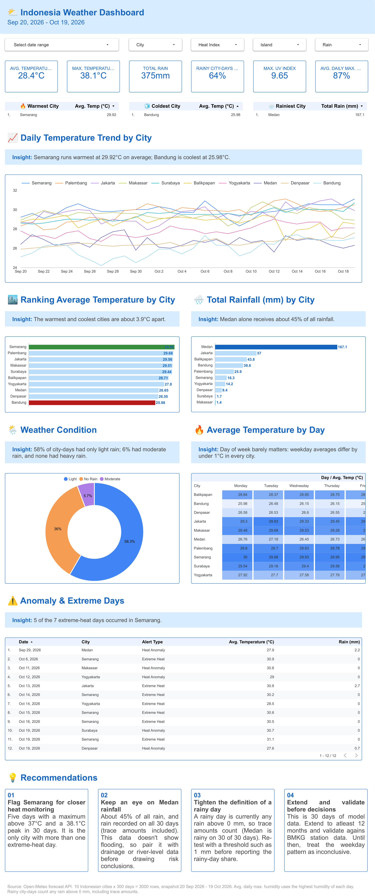

# Indonesia Weather ETL Pipeline & Dashboard

End-to-end data project: pull daily weather for 10 Indonesian cities from the Open-Meteo API, clean and enrich it in Python, load it into a BigQuery star schema, and explore it in a Looker Studio dashboard.

> **Course project** (Purwadhika DS & ML Program). The assignment template defined the fact/dimension schema. The extract, transform, load, SQL view, analytical queries, corrections to the template, and the dashboard were built by me.

**Live dashboard:** [https://datastudio.google.com/reporting/4a1eaf36-869a-4483-bae4-bc20fe16183d](https://datastudio.google.com/reporting/4a1eaf36-869a-4483-bae4-bc20fe16183d)



## Business questions

1. Which city is the hottest and which is the rainiest in the period?
2. How does daily temperature trend for each city?
3. How many days are rainy, and how intense is the rain?
4. Is there a hottest day of the week?
5. Are there anomalous or extreme-temperature days?
6. How does the UV index compare across cities?

The dashboard is designed for operations or regional managers and for health and safety teams who compare heat and rainfall risk across cities.

## Architecture

```
Open-Meteo API  ->  Python (requests, pandas)  ->  BigQuery (weather_dwh)  ->  Looker Studio
   extract              transform + validate        fact + dim + view            dashboard
```

| Step      | What happens                                                                                                                                  |
| --------- | --------------------------------------------------------------------------------------------------------------------------------------------- |
| Extract   | 10 cities x 30 days x 11 daily variables from the Open-Meteo forecast endpoint (300 rows)                                                     |
| Transform | 9 steps (T1-T9): types, nulls, range assertions, time dimensions, sunshine hours, heat index, categories, flags and anomalies, de-duplication |
| Load      | `fact_weather_daily`, `dim_city`, and the view `vw_dashboard` in BigQuery                                                               |
| Analyze   | 6 SQL queries (Q1-Q6), one per dashboard component                                                                                            |
| Visualize | Looker Studio dashboard on top of `vw_dashboard`                                                                                            |

## Data

- **Source:** [Open-Meteo](https://open-meteo.com/) forecast API (model-based data, not weather-station measurements)
- **Period:** 20 Sep 2026 - 19 Oct 2026
- **Cities:** Jakarta, Surabaya, Bandung, Medan, Makassar, Semarang, Palembang, Denpasar, Yogyakarta, Balikpapan
- **Raw columns (17):** temperatures (max, min, mean), precipitation, rain, wind speed and gusts, maximum relative humidity, UV index, WMO weather code, sunshine duration, plus identifiers and fetch time
- **Derived features (17):** year, month, week, day name, `is_weekend`, `season`, sunshine hours, temperature range, heat index and category, weather label, rain category, UV category, `is_rainy`, `is_extreme_heat`, `is_anomaly_temp`
- Weather data by Open-Meteo.com

### Warehouse schema

```
weather_dwh
  |- fact_weather_daily   one row per city per day (measures + derived features)
  |- dim_city             city metadata (province, island, latitude, longitude)
  `- vw_dashboard         fact joined to dim_city, the dashboard data source
```

## Key findings

| Metric                         | Value    |
| ------------------------------ | -------- |
| Average temperature            | 28.4 °C |
| Maximum temperature            | 38.1 °C |
| Total rain                     | 375 mm   |
| Rainy city-days                | 64%      |
| Maximum UV index               | 9.65     |
| Average daily maximum humidity | 87%      |

- **Warmest / coolest city:** Semarang (29.92 °C) and Bandung (25.98 °C).
- **Rainiest city:** Medan, 167.1 mm of the 375 mm total.
- **Extreme heat:** Semarang accounts for 5 of the 7 Extreme Heat days (daily maximum above 37 °C).
- **Rain intensity:** light rain 58.3% of city-days, moderate rain 5.7%, no heavy rain.
- **Day of week:** each city's average temperature is nearly the same on every weekday.

## Design decisions

| Area            | This project                                                                 |
| --------------- | ---------------------------------------------------------------------------- |
| `is_weekend`    | `>= 5` (Saturday and Sunday)                                                 |
| `season`        | `Dry` (Apr-Sep) / `Wet` (Oct-Mar), matching Indonesia                        |
| `uv_category`   | WHO scale: Low < 3, Moderate 3-<6, High 6-<8, Very High 8-<11, Extreme >= 11 |
| Dates           | pinned dates plus a frozen CSV snapshot                                      |

## Limitations

- 30 days of model data for 10 cities is too short to describe climate or support operational decisions. Extending to at least 12 months and validating against BMKG station data is the next step.
- The forecast endpoint can revise recent values, so pulling the same dates again does not always give identical numbers. That is why the notebook reads a frozen snapshot by default.
- `humidity_pct` is the daily **maximum** humidity. The heat index pairs it with mean temperature, so it tends to overestimate.
- `is_anomaly_temp` flags only unusually **hot** days (daily mean above city mean + 2 standard deviations).
- A rainy day is any `rain_mm > 0`, which includes trace amounts. A threshold such as 1 mm should be tested before reporting the rainy-day share.
- Each weekday cell in the heatmap averages only 4-5 days, so the weekday pattern is inconclusive.
- The pipeline is run manually (no scheduler). Loads use full replace, so reruns are idempotent.
- The project uses the BigQuery Sandbox (no billing): tables expire automatically. The data is preserved in `data/`.

## Repository structure

```
|- data/
|   `- dataset_raw.csv              frozen raw snapshot used by the dashboard
|   `dim_city.csv
|   `fact_weather_daily.csv
|- docs/                            dashboard screenshots
|- notebook/
|   `.env.example                   
|   `- Weather_ETL_Pipeline.ipynb   notebook to build the pipeline
|- sql/
|   `- vw_dashboard.sql             view definition
|- requirements.txt
|- README.md
```

## How to run

Developed with Python 3.13.9.

```bash
python -m venv .venv
source .venv/bin/activate        
pip install -r requirements.txt
jupyter lab                    
```

**Without any credentials:** the notebook reads `data/dataset_raw.csv` (`USE_SNAPSHOT = True`), so Steps 0-2 (extract from snapshot, transform, validation) run as they are. A reconciliation cell compares six KPIs with the dashboard.

**With BigQuery (Steps 3-4):**

1. Create a GCP project and enable the BigQuery API.
2. Create a service account with the roles *BigQuery Data Editor* and *BigQuery Job User*, and download its JSON key.
3. Copy `.env.example` to `.env` in the `notebook/` folder and fill in `PROJECT_ID` and `CREDENTIAL_PATH`. Keep the key file **outside** the repository.
4. Restart the kernel and run the notebook.

Notebook flags (Step 0):

| Flag             | Default   | Meaning                                                                       |
| ---------------- | --------- | ----------------------------------------------------------------------------- |
| `USE_SNAPSHOT` | `True`  | Read `data/dataset_raw.csv`. Set `False` to pull fresh data from the API. |
| `LOAD_TO_BQ`   | `False` | Set `True` only if you want to overwrite the BigQuery tables and view.      |

## Tech stack

Python (pandas, numpy, requests), pandas-gbq, Google BigQuery (SQL), Looker Studio, python-dotenv, Jupyter.

## Contact

* **Name:** Angela Adytha Putri
* **Email:** angel.adytha@gmail.com
* **GitHub:** [https://github.com/angela-adytha](https://github.com/angela-adytha)
* **LinkedIn:** [https://www.linkedin.com/in/angela-adytha-putri-a8b6082b9/](https://www.linkedin.com/in/angela-adytha-putri-a8b6082b9/)